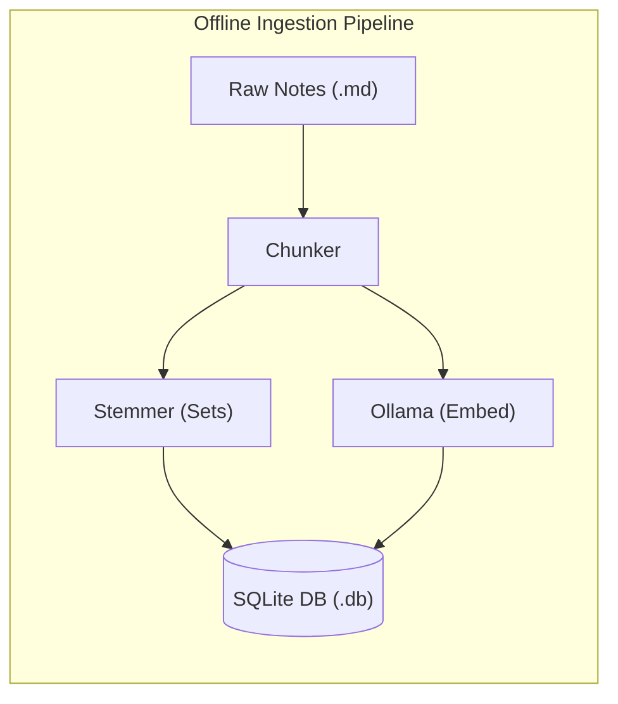
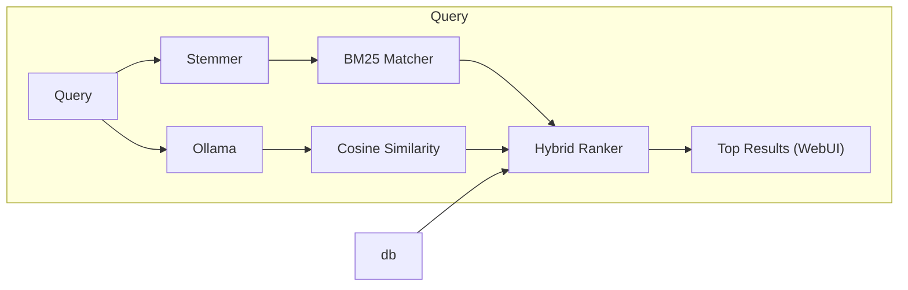

# cosi

(Pronounced "Cozy"; From **co**sine **si**milarity)

A lightweight, blazingly fast, and completely offline search utility for personal notes and markdown documents. This project merges classical discrete mathematics with modern vector embeddings to provide robust hybrid retrieval.

Developed as an extra credit project for **CSC 2510: Theoretical Foundations for Computer Science** under Dr. Suxing Liu.

---

## System Architecture

The project splits execution into two highly optimized pipelines:

---

## Tech Stack & Prerequisites

This is a record of *my* environment while developing this project.

- **Development Environment:** NixOS / Linux
- **Deployment Platform**: Docker (Cross-platform compatability)
- **Runtime:** Python 3.x
- **Libraries:** 
  - `nltk` (Tokenization & stemming baseline)
  - `sqlite3` (Built-in SQL relational database)
  - `numpy` or `scikit-learn` (Optimized matrix calculations for Cosine Similarity)
- **Local AI:** Ollama running `nomic-embed-text` (a fully auditable, open-data text embedding model)

---

## Quick Start & Setup

To be written. Once the functionality is complete, the user-end will be considered.

---

## Developer Log

- **2026-08-29:** Initialized private Git repository. Verified professor's BM25 benchmark script running successfully on NixOS.
- **2026-09-16:** Implemented primary functionality, including the offline ingestion pipeline (SQLite schema, incremental file-hash checking, paragraph chunker, Porter stemming, Ollama embedding calls), the hybrid BM25 + cosine similarity search engine, and the Flask WebUI. Verified end-to-end against real notes with Ollama running locally -- confirmed both keyword and vector branches contributing to blended rankings. Stress-tested ingestion against edge cases (empty files, unicode/emoji content, oversized paragraphs, unsupported file types) and fixed two real bugs found in the process: unsupported file types (PDF/DOCX/TXT) were being silently ignored instead of flagged, and undersized trailing chunks were polluting the index instead of merging into the preceding chunk. Added in-memory corpus caching to cosi_engine.py (avoids rebuilding the BM25 index and re-reading embeddings on every query), a relative-threshold cutoff on blended scores described in the design doc), client-side highlighting of matched query terms in search results, and refresh-index stats reporting in the WebUI.
