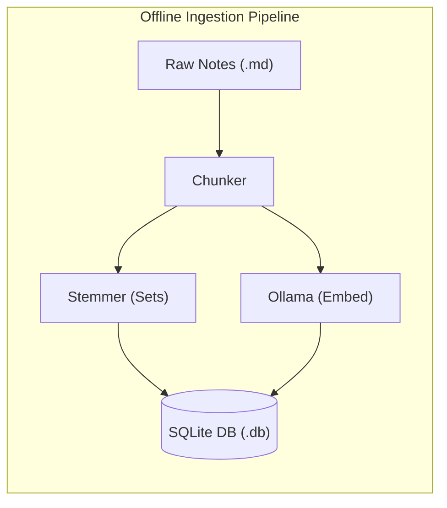
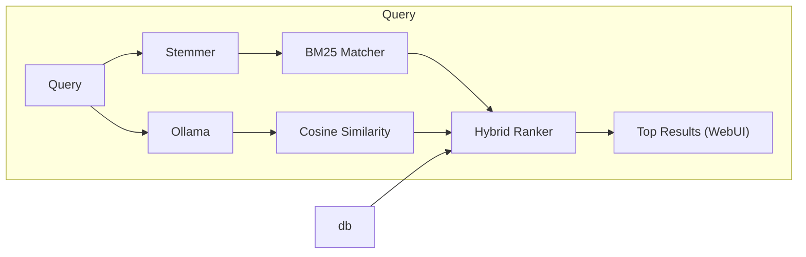

# cosi

(Pronounced "Cozy"; From **cosi**ne similarity)

A lightweight, blazingly fast, and completely offline search utility for personal notes and markdown documents. This project merges classical discrete mathematics with modern vector embeddings to provide robust hybrid retrieval.

Developed as an extra credit project for **CSC 2510: Theoretical Foundations for Computer Science** under Dr. Suxing Liu.

---

## System Architecture

The project splits execution into two highly optimized pipelines:





---

## Tech Stack & Prerequisites

This is a record of *my* environment while developing this project.

- **Development Environment:** NixOS / Linux
- **Deployment Platform**: Docker (Cross-platform compatability)
- **Runtime:** Python 3.x
- **Libraries:** 
  - `nltk` (Tokenization & stemming baseline)
  - `sqlite3` (Built-in SQL relational database)
  - `numpy` or `scikit-learn` (Optimized matrix calculations for Cosine Similarity)
- **Local AI:** Ollama running `nomic-embed-text` (a fully auditable, open-data text embedding model)

---

## Quick Start & Setup

cosi runs in Docker. Ollama runs separately on your own machine (not in the container), and cosi connects to it.

### 1. Install and start Ollama (on the host)

Install Ollama from <https://ollama.com>, then pull the embedding model:

```bash
ollama pull nomic-embed-text
```

Make sure the Ollama server is running (the desktop app does this automatically; otherwise run `ollama serve`).

> Ollama is optional. Without it, cosi still works in **keyword-only (BM25) mode** and prints a warning at startup.

### 2. Start cosi

**macOS / Windows (Docker Desktop):**

```bash
docker compose up --build
```

**Linux:**

```bash
docker compose -f docker-compose.yml -f docker-compose.linux.yml up --build
```

The Linux variant uses host networking, because Ollama on Linux only listens on `127.0.0.1` by default and a normally-networked container can't reach it.

### 3. Use it

1. Open <http://localhost:8000>.
2. Click **Refresh Index** to index the notes in `notes/` (needed on first run and after editing notes).
3. Search.

Your notes folder (`./notes`) and the index (`./data/cosi.db`) are mounted into the container, so edits to your notes are visible after a refresh and the index survives restarts.

### Checking the connection

- <http://localhost:8000/api/status> shows whether search is running in `hybrid` or `keyword` mode, and why.
- The container logs (`docker compose logs cosi`) show the Ollama check made at startup.

### Without Docker (development)

```bash
pip install -r requirements.txt
python app.py              # COSI_DEBUG=1 python app.py for Flask debug mode
python tests/test_ollama.py
```

### Configuration

All settings are environment variables (see `config.py`):

| Variable | Default | Purpose |
| :--- | :--- | :--- |
| `COSI_OLLAMA_URL` | `http://localhost:11434` (container: `http://host.docker.internal:11434`) | Where Ollama is reachable |
| `COSI_EMBED_MODEL` | `nomic-embed-text` | Embedding model |
| `COSI_OLLAMA_TIMEOUT` | `30` | Seconds to wait for an embedding |
| `COSI_BIND` / `COSI_PORT` | `0.0.0.0` / `8000` | Web server address |
| `COSI_DEBUG` | `0` | `1` enables Flask debug mode (local development only) |

---

## Developer Log

- **2026-08-29:** Initialized private Git repository. Verified professor's BM25 benchmark script running successfully on NixOS.

