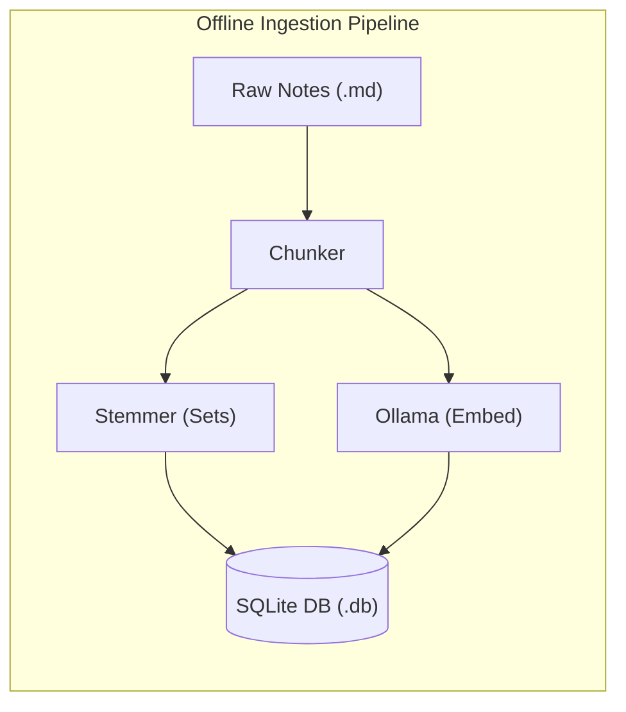
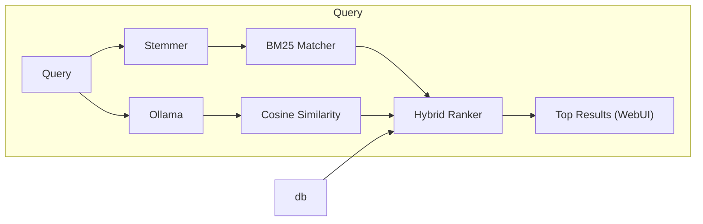

# cosi

(Pronounced "Cozy"; From **cosi**ne similarity)

A lightweight, blazingly fast, and completely offline search utility for personal notes and markdown documents. This project merges classical discrete mathematics with modern vector embeddings to provide robust hybrid retrieval.

Developed as an extra credit project for **CSC 2510: Theoretical Foundations for Computer Science** under Dr. Suxing Liu.

---

## System Architecture

The project splits execution into two highly optimized pipelines:

---

## Tech Stack & Prerequisites

This is a record of *my* environment while developing this project.

- **Environment:** NixOS / Linux
- **Runtime:** Python 3.x
- **Libraries:** 
  - `nltk` (Tokenization & stemming baseline)
  - `sqlite3` (Built-in SQL relational database)
  - `numpy` or `scikit-learn` (Optimized matrix calculations for Cosine Similarity)
- **Local AI:** Ollama running `nomic-embed-text` (a fully auditable, open-data text embedding model)

---

## Quick Start & Setup

To be written. Once the functionality is complete, the user-end will be considered.

---

## Developer Log

- **2026-08-29:** Initialized private Git repository. Verified professor's BM25 benchmark script running successfully on NixOS.

