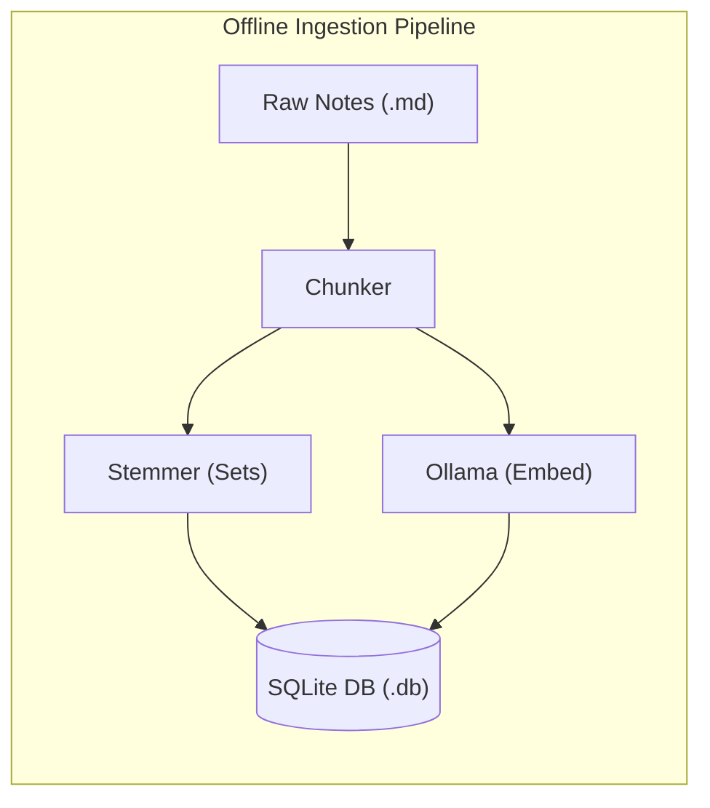
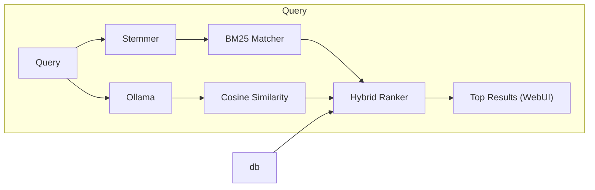

# cosi

(Pronounced "Cozy"; From **cosi**ne similarity)

A lightweight and completely offline search utility for personal notes and markdown documents. This project merges classical discrete mathematics with modern vector embeddings to provide robust hybrid retrieval.

Developed as an extra credit project for **CSC 2510: Theoretical Foundations for Computer Science** under Dr. Suxing Liu.

---

## System Architecture

The project splits execution into two highly optimized pipelines:





---

## Tech Stack & Prerequisites

This is a record of *my* environment while developing this project.

- **Development Environment:** NixOS / Linux
- **Deployment Platform**: Docker (Cross-platform compatability)
- **Runtime:** Python 3.x
- **Libraries:** 
  - `nltk` (Tokenization & stemming baseline)
  - `sqlite3` (Built-in SQL relational database)
  - `numpy` or `scikit-learn` (Optimized matrix calculations for Cosine Similarity)
- **Local AI:** Ollama running `nomic-embed-text` (a fully auditable, open-data text embedding model)

---

## Quick Start & Setup

cosi runs in Docker. Ollama runs separately on your own machine (not in the container), and cosi connects to it.

### 1. Install and start Ollama (on the host)

Install Ollama from <https://ollama.com>, then pull the embedding model:

```bash
ollama pull nomic-embed-text
```

Make sure the Ollama server is running (the desktop app does this automatically; otherwise run `ollama serve`).

> Ollama is optional. Without it (not installed, or not running), cosi still works in **keyword-only (BM25) mode**: it prints a warning at startup, and the page shows a link to <https://ollama.com/download> plus the command to run. Once Ollama is running with the model pulled, click **Refresh Index** to add the meaning-search data; the page switches to hybrid mode on its own.

### 2. Start cosi

**macOS / Windows (Docker Desktop):**

```bash
docker compose up --build
```

**Linux:**

```bash
docker compose -f docker-compose.yml -f docker-compose.linux.yml up --build
```

The Linux variant uses host networking, because Ollama on Linux only listens on `127.0.0.1` by default and a normally-networked container can't reach it.

### 3. Use it

1. Open <http://localhost:8000>.
2. Click **Refresh Index** to index the notes in `notes/` (needed on first run and after editing notes). The first index of a large folder takes a while, since every passage is embedded; after that, a refresh only re-embeds notes that changed.
3. Search.

Your notes folder (`./notes`) and the index (`./data/cosi.db`) are mounted into the container, so edits to your notes are visible after a refresh and the index survives restarts.

The code, page templates and styles are copied into the image when it is built, so after changing any `.py`, `.html`, `.css` or `.js` file, start with `--build` to see the change. Note changes only need **Refresh Index**.

### Checking the connection

- <http://localhost:8000/api/status> shows whether search is running in `hybrid` or `keyword` mode, and why.
- The container logs (`docker compose logs cosi`) show the Ollama check made at startup.

### Without Docker (development)

```bash
pip install -r requirements.txt
python app.py              # COSI_DEBUG=1 python app.py for Flask debug mode
python tests/test_ollama.py
```

### Configuration

All settings are environment variables (see `config.py`):

| Variable | Default | Purpose |
| :--- | :--- | :--- |
| `COSI_OLLAMA_URL` | `http://localhost:11434` (container: `http://host.docker.internal:11434`) | Where Ollama is reachable |
| `COSI_EMBED_MODEL` | `nomic-embed-text` | Embedding model |
| `COSI_OLLAMA_TIMEOUT` | `30` | Seconds to wait for an embedding |
| `COSI_EMBED_BATCH` | `32` | Passages per embedding request while indexing (higher is faster on a GPU; lower it if a slow CPU times out) |
| `COSI_NOTES_DIR` | `./notes` | Folder of `.md` notes to index |
| `COSI_BIND` / `COSI_PORT` | `0.0.0.0` / `8000` | Web server address |
| `COSI_DEBUG` | `0` | `1` enables Flask debug mode (local development only) |

---

## Searching your own notes

cosi indexes every `.md` file in a folder (subfolders included). The default is `notes/`, which holds six short sample travel notes. To search a different folder:

```bash
COSI_NOTES_DIR=~/path/to/notes python app.py       # then click Refresh Index
```

With Docker, set `COSI_NOTES` when starting:

```bash
COSI_NOTES=~/path/to/notes docker compose -f docker-compose.yml -f docker-compose.linux.yml up --build
```

## Evaluation

`eval/run_eval.py` measures how often each search method puts the right passage first, using 44 hand-labeled questions about the sample notes (`eval/queries_travel.json`). It builds its own temporary index, so `data/cosi.db` is never touched. With Ollama running:

```bash
python eval/run_eval.py
```

It compares keyword-only (BM25), meaning-only (cosine) and cosi's blend, tries every blend weight from 0 to 1, and checks whether differences are statistically significant. Results go to `eval/results/` (`summary.md`, `summary.json`, `per_query.csv`). `--no-embed` runs the keyword branch only, without Ollama.

The 0.2 / 0.8 blend weight comes from this sweep: on the sample notes it scored slightly above meaning-only search (MRR 0.95 vs 0.94), while the original 0.4 / 0.6 scored below it.

## Tests

```bash
python -m pytest tests/
```

---

## Developer Log

- **2026-08-29:** Initialized private Git repository. Verified professor's BM25 benchmark script running successfully on NixOS.
- **2026-10:** Docker setup, configurable Ollama URL and notes folder, Ollama health check with keyword-only fallback, sentence-aware chunking, per-result score breakdown in the UI, unit tests.
- **2026-11:** Added a retrieval evaluation; lowered the keyword weight in the blend from 0.4 to 0.2 based on it. Indexing now sends passages to Ollama in batches (`/api/embed`) instead of one request per passage, batching across files so vaults of short notes benefit too; unreadable files are skipped and reported instead of stopping a refresh.

